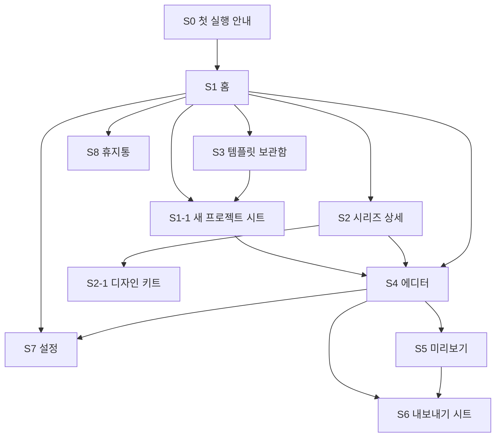

# 정보 구조 (IA) v0.1

> 기능 명세서 v0.6의 **P0~P2 전체 기능**을 화면에 배치한 문서.
> 기능 이름 옆 괄호는 명세서 ID. 🍎 = 앱(맥북) 단계에서 동작, 웹 단계에서는 숨기거나 "앱에서 지원"으로 표시.

---

## 1. 전체 화면 지도

> 와이어프레임(Figma, iPad Pro 13 가로 · 라이트): [캐러셀 디자인 툴 - 와이어프레임](https://www.figma.com/design/elMdaecHpdtK8MIBpkKazh) — 화면 22개, 컴포넌트 15종 + 아이콘 41종
>
> 보기 쉬운 트리 다이어그램(FigJam): [캐러셀 디자인 툴 IA](https://www.figma.com/board/Mp6utyKiDJWgS7BKSOIa1j) — 1. 전체 구조, 2. 에디터 상세, 3. 디자인 패널 섹션



| 화면 | 역할 |
|---|---|
| **S0** 첫 실행 안내 | 처음 한 번. 홈 화면 추가 안내(웹 단계), 기본 사용법 |
| **S1** 홈 | 프로젝트와 시리즈 보관함 |
| **S1-1** 새 프로젝트 시트 | 규격, 장수, 시리즈, 템플릿 선택 |
| **S2** 시리즈 상세 | 회차 목록과 시리즈 디자인 키트 |
| **S3** 템플릿 보관함 | 공용, 시리즈별, 기본 제공 템플릿 |
| **S4** 에디터 | 실제 작업 화면 (편집 모드 / 손글씨 모드) |
| **S5** 미리보기 | 인스타 피드와 프로필 그리드 미리보기 |
| **S6** 내보내기 시트 | 형식, 범위, 저장 위치 |
| **S7** 설정 | 펜슬, 제스처, 단축키, 기기, 폰트, 저장 공간 |
| **S8** 휴지통 | 삭제한 프로젝트 30일 보관 |

---

## 2. 화면별 상세

### S0. 첫 실행 안내 (P1)

- 웹 단계: "홈 화면에 추가해야 작업이 안전하게 저장돼요" 안내 (검토 문서 1-F)
- 기본 제스처 소개: 두 손가락 탭 실행 취소 등 (DR-14)
- 펜슬 사용 여부, 손가락으로 그리기 끄기 선택 (DR-13)

### S1. 홈

```
┌──────────────────────────────────────────────────────────┐
│ [사이드바]          │  [정렬 ▾] [보기 ▾]   [+ 새 시리즈] [+ 새 프로젝트] │
│  전체 프로젝트       │                                         │
│  시리즈             │   ┌────┐ ┌────┐ ┌────┐ ┌────┐           │
│   ├ 인스타툰 A       │   │    │ │    │ │    │ │    │  프로젝트 카드 │
│   └ 정보 캐러셀 B     │   └────┘ └────┘ └────┘ └────┘           │
│  템플릿             │                                         │
│  휴지통             │                                         │
│  ─────            │                                         │
│  가져오기           │                                         │
│  설정              │                                         │
└──────────────────────────────────────────────────────────┘
```

| 영역 | 기능 |
|---|---|
| 사이드바 | 전체 프로젝트, 시리즈 목록, 템플릿(→S3), 휴지통(→S8), 가져오기, 설정(→S7) |
| 상단 | 정렬: 최근순/이름순, 보기: 시리즈별/전체 (PJ-03), 새 시리즈 (SR-01), 새 프로젝트(→S1-1) |
| 프로젝트 카드 | 썸네일, 이름, 수정일, 장수 (PJ-03). 탭하면 에디터(→S4) |
| 카드 메뉴 (길게 누르기) | 이름 변경, 복제, 삭제 (PJ-04), 시리즈로 이동/빼기 (SR-02), 프로젝트 파일로 내보내기 (PJ-06) |
| 가져오기 | 프로젝트 파일, 시리즈 파일 불러오기 (PJ-06, SR-10) |
| 드래그 | 프로젝트 카드를 사이드바 시리즈로 끌어 넣기 (SR-02) |
| 시리즈 메뉴 | 이름 변경, 대표 이미지, 메모, 삭제 (SR-01), 시리즈 내보내기 (SR-10) |
| 상태 | 저장 공간 경고, iCloud 동기화 상태 🍎 (PJ-08) |

### S1-1. 새 프로젝트 시트

| 항목 | 내용 |
|---|---|
| 규격 | 4:5 / 3:4 / 1:1 / 16:9 / 직접 입력 + **세로/가로 전환 버튼** (PJ-01). 인스타 범위 밖이면 경고 |
| 슬라이드 수 | 1~20 (PJ-02) |
| 시리즈 | 없음 / 시리즈 선택 (SR-02). 시리즈를 고르면 시리즈 템플릿이 기본 선택 (SR-04) |
| 템플릿 | 빈 캔버스 / 내 템플릿 / 시리즈 템플릿 / 기본 제공 템플릿 (TP-05, TP-08) |
| 이름 | 기본값 "제목 없음", 시리즈 회차면 "시리즈명 N화" (SR-08) |

### S2. 시리즈 상세

| 영역 | 기능 |
|---|---|
| 상단 | 시리즈 이름, 대표 이미지, 메모, **다음 회차 만들기** 버튼 (SR-08) |
| 탭 1: 회차 | 회차 목록 (드래그로 순서 변경), 목록/그리드 보기 전환 (SR-03) |
| 탭 2: 디자인 키트 | → S2-1 |
| 메뉴 | 시리즈 내보내기 (SR-10), 시리즈 미리보기 그리드(→S5 프로필 그리드, IG-05) |

#### S2-1. 디자인 키트

| 섹션 | 기능 |
|---|---|
| 템플릿 | 시리즈 템플릿 목록, 기본 템플릿 지정 (SR-04) |
| 팔레트 | 시리즈 팔레트 (SR-05, CL-06) |
| 즐겨찾기 폰트 | 시리즈 폰트 (SR-06) |
| 텍스트 스타일 | 제목/본문 등 (SR-07, TX-21) |
| 레이아웃 프리셋 | 가이드, 그리드 (SR-07, AL-10) |
| 변경 반영 | 키트를 고쳤을 때 "기존 회차에도 적용" 선택 (SR-09) |

### S3. 템플릿 보관함

| 영역 | 기능 |
|---|---|
| 분류 탭 | 내 템플릿(공용) / 시리즈별 / 기본 제공 (TP-02, TP-08) |
| 필터 | 프로젝트 템플릿 / 슬라이드 템플릿 (TP-03) |
| 카드 메뉴 | 이름 변경, 삭제, 폴더 이동 (TP-07), 파일로 공유 (TP-09) |
| 탭하면 | 이 템플릿으로 새 프로젝트(→S1-1) |
| 가져오기 | 템플릿 파일 불러오기 (TP-09) |

---

### S4. 에디터

```
┌────────────────────────────────────────────────────────────────┐
│ ← 제목  ↶ ↷        [이어 보기|한 장씩]  [편집|손글씨]     ▷미리보기  ⇪내보내기  ⋯ │  4-1 상단 바
├────┬───────────────────────────────────────────────┬───────────┤
│ 도구 │                                               │ [디자인|레이어] │
│  ▢  │                                               │  위치·크기    │
│  T  │              4-4 캔버스                        │  채우기       │
│  ✎  │                                               │  텍스트 …     │
│ …  │                                               │  4-5 오른쪽 패널 │
│4-2/3│                                               │             │
├────┴───────────────────────────────────────────────┴───────────┤
│  [1] [2] [3] [4] …  [+]                                   3/20    │  4-6 슬라이드 바
└────────────────────────────────────────────────────────────────┘
```

#### 4-1. 상단 바

| 항목 | 기능 |
|---|---|
| ← | 홈으로 (자동 저장됨, PJ-05) |
| 제목 | 탭하면 이름 변경 (PJ-04), 저장 상태 표시 |
| ↶ ↷ | 실행 취소/다시 실행 (OB-14). 항상 보임 (DR-14 대안) |
| 보기 모드 | 이어 보기 / 한 장씩 (CV-01, CV-02, CV-03) |
| 작업 모드 | 편집 / 손글씨 (DR-01) |
| 미리보기 | → S5 |
| 내보내기 | → S6 |
| ⋯ 더보기 | 아래 표 |

**⋯ 더보기 메뉴**

| 그룹 | 항목 |
|---|---|
| 프로젝트 | 규격 변경 (PJ-09), 프로젝트 파일로 내보내기 (PJ-06), 시리즈로 이동 (SR-02) |
| 템플릿 | 프로젝트를 템플릿으로 저장, 현재 슬라이드를 템플릿으로 저장 (TP-01, TP-02, TP-03), 템플릿 슬라이드 추가 (TP-06) |
| 보기 | 눈금자 (AL-06), 가이드 보기/잠금/모두 지우기 (AL-07), 레이아웃 그리드 (AL-08), 스냅 설정 (AL-09), 썸네일 잘림 영역 (CV-16), 인스타 가림 영역 (CV-17) |
| 도움말 | 단축키 목록 (13장), 제스처 안내 |
| 설정 | → S7 |

#### 4-2. 왼쪽 도구 바: 편집 모드

| 도구 | 하위 항목 |
|---|---|
| 선택 (V) | 다중 선택 버튼 (OB-02, OB-15) |
| 텍스트 (T) | 탭해서 텍스트 생성 (TX-01) |
| 도형 | 사각형(R), 원(O), 선(L) (SH-01), 화살표, 다각형, 별 (SH-02) |
| 펜툴 (P) | (SH-06) |
| 말풍선 | 원형 / 네모 (SH-08, SH-09), 생각 풍선, 외침 (SH-14) |
| 이미지 | 사진 앱 / 파일 앱 (IM-01, IM-02). 큰 사진은 불러올 때 자동 최적화 (IM-08) |
| 동영상 | 사진 앱 / 파일 앱 (VD-01) → 10초 초과 시 S4-영상 시트 |
| 하단 | 복제 버튼 (OB-15), 실행 취소 대안 |

#### 4-3. 왼쪽 도구 바: 손글씨 모드

Procreate처럼 왼쪽에 크기/불투명도 슬라이더를 둔다.

| 도구 | 하위 항목 |
|---|---|
| 브러쉬 (B) | 종류: 펜, 붓펜, 형광펜, 연필, 마커, 에어브러시 (DR-05, DR-06). 설정 팝오버: 크기, 불투명도, 손떨림 보정 (DR-07), **필압 켜기/끄기** (DR-03), **기울기 켜기/끄기** (DR-04), 프리셋 저장 (DR-19) |
| 지우개 (E) | 브러쉬 모양 선택, 크기 (DR-10) |
| 올가미 | 선택 후 떠다니는 메뉴: 이동/크기/회전, 복사, 삭제, 색 변경 (DR-11) |
| 페인트통 | (DR-18) |
| 스포이드 (I) | (CL-03). 손가락 길게 누르기로도 (DR-14) |
| 색상 | → 색상 선택기 팝오버 |
| 슬라이더 | 크기, 불투명도 |
| 토글 | 직선 보정 (DR-08), 도형 보정 (DR-09), 손가락으로 그리기 (DR-13) |
| 레이어 표시 | 지금 그리는 손그림 레이어 이름, 새 손그림 레이어 (DR-02), 클리핑 켜기 (DR-12) |

#### 4-4. 캔버스

| 요소 | 기능 |
|---|---|
| 보기 | 이어 보기: 슬라이드 가로 나열 + 경계선 (CV-01, CV-04) / 한 장씩: 현재 장만, 경계 넘는 부분은 잘려 보임 (CV-02, CV-05) |
| 비율 다른 슬라이드 | 세로 가운데 정렬, 경계 오브젝트 경고 (CV-15) |
| 이동과 확대 | 핀치, 두 손가락 드래그, 화면 맞춤 상태 스와이프로 넘기기 (CV-07, CV-13, CV-14) |
| 선택 핸들 | 탭 선택 (OB-01), 이동, 방향키 이동 (OB-03), 크기와 비율 고정 (OB-04), 회전 (OB-05), 0°/45°/90° 자동 스냅 (OB-15) |
| 안내선 | 스마트 가이드, 간격 표시 (AL-04, AL-05) |
| 오버레이 | 눈금자, 가이드, 그리드 (AL-06~08), 썸네일 잘림 (CV-16), 인스타 가림 영역 (CV-17) |
| 말풍선 | 꼬리 끝 핸들, 꼬리 폭 핸들, 몸통 핸들 (SH-10, SH-11) |
| 펜툴 | 점 찍기/곡선, 더블탭으로 점 편집 (SH-06, SH-07) |
| 텍스트 | 더블탭으로 편집, 부분 선택 후 서식 (TX-03, TX-20) |
| 이미지 | 더블탭으로 크롭 모드 (IM-03, IM-04) |
| 동영상 | 선택하면 재생/일시정지, 반복, 타임라인 (VD-02). 영상 위에 텍스트, 도형, 손그림을 얹어 배치 (VD-08) |
| 자리표시자 | 템플릿으로 시작한 프로젝트에서 이미지/텍스트 자리를 탭하면 바로 교체 (TP-04) |
| 길게 누르기 메뉴 | 아래 표 |
| 제스처 | 두/세/네 손가락 탭 (DR-14) |

**길게 누르기 메뉴 (오브젝트)**

복사, 잘라내기, 붙여넣기, 같은 위치에 붙여넣기, 복제 (OB-12) · 삭제 · 그룹/해제 (OB-13) · 순서: 맨 앞/앞/뒤/맨 뒤 (LY-02) · 숨기기/잠금 (LY-04) · 클리핑 마스크 (LY-07) · 마스크로 사용 (LY-08) · 뒤집기 (OB-06) · 이미지 교체 (IM-05) · 슬라이드 템플릿으로 저장 (TP-03) · 자리표시자로 지정 (TP-04)

#### 4-5. 오른쪽 패널

탭 2개: **[디자인] [레이어]**. 디자인 탭은 선택한 것에 따라 섹션이 바뀐다 (Figma 방식).

**디자인 탭: 선택에 따른 섹션**

| 선택 상태 | 표시되는 섹션 |
|---|---|
| 아무것도 / 슬라이드 | 슬라이드, 레이아웃 |
| 이미지 | 위치·크기, 레이어, 이미지, 효과 |
| 도형 | 위치·크기, 레이어, 채우기, 테두리, 효과 |
| 펜툴 도형 | 위치·크기, 레이어, 채우기, 테두리, 효과 |
| 말풍선 | 위치·크기, 레이어, 말풍선, 채우기, 테두리, 텍스트 |
| 텍스트 | 위치·크기, 레이어, 텍스트, 텍스트 배경, 효과 |
| 동영상 | 위치·크기, 레이어, 동영상 |
| 손그림 레이어 | 위치·크기, 레이어, "손글씨 모드에서 편집" 버튼 |
| 여러 개 | 위치·크기("혼합" 표시), 정렬, 레이어 |

**섹션별 항목**

| 섹션 | 항목 |
|---|---|
| 슬라이드 | 채우기: 색, HEX, 불투명도 (CV-10) / 그라디언트, 이미지 (CV-11) / 채우기 추가 (CV-12) · 이 슬라이드 비율 (CV-15) |
| 레이아웃 | 레이아웃 그리드: 열, 행, 여백, 간격 (AL-08) · 프리셋 불러오기/저장 (AL-10) |
| 위치·크기 | X, Y, W, H, 회전, 모서리 반경 (OB-07, SH-05) · 비율 고정 · 좌표는 현재 슬라이드 기준 (OB-08) · 기준점 9개 (OB-11) · 수식 입력 (OB-10) · 여러 개면 "혼합" (OB-09) |
| 정렬 | 6방향 정렬 (AL-01, AL-02), 간격 분배 (AL-03), 뒤집기 (OB-06) |
| 레이어 | 불투명도 (LY-05), 블렌드 모드 16종 (LY-06) |
| 채우기 | 단색/그라디언트/없음 (SH-03, CL-09) |
| 테두리 | 두께, 색, 위치, 점선 (SH-04) |
| 효과 | 그림자 (IM-07, TX-19) |
| 텍스트 | 폰트(→폰트 선택기, TX-04), 굵기 (TX-05), 크기, 색 (TX-06), 자간 %/px (TX-07), 행간 자동/%/px (TX-08), 장평 (TX-09), 이탤릭, 기울기 각도 (TX-10, TX-11), 밑줄, 취소선 (TX-12), 정렬 (TX-13), 박스 방식 (TX-02), 줄바꿈 단위 (아래 결정 사항), 글자 테두리 (TX-14), 텍스트 스타일 적용/저장 (TX-21), 세로쓰기, 곡선 (TX-22) |
| 텍스트 배경 | 색, 불투명도, 여백 (TX-15), 모서리 라운딩 전체/개별 (TX-16), 박스 테두리 (TX-17), 전체 박스/줄마다 박스 (TX-18) |
| 이미지 | 크롭 (IM-03), 프레임 안 위치 (IM-04), 교체 (IM-05), 보정: 밝기, 대비, 채도, 색온도, 흐림 (IM-06), 모서리, 테두리 (IM-07), 배경 제거 🍎 (IM-09) |
| 말풍선 | 몸통 모양 원형/네모, 라운딩 (SH-09), 꼬리 폭, 꼬리 없음 (SH-10), 추가 모양 (SH-14). 글자는 텍스트 섹션 그대로 사용, 몸통 안 자동 줄바꿈 (SH-12). 채우기/테두리는 몸통과 꼬리에 이어서 적용 (SH-13) |
| 동영상 | 구간과 배속(→영상 시트, VD-03, VD-11), 화면 크롭 (VD-04), 소리 끄기 (VD-05), 오디오 넣기, 볼륨, 시작 지점 (VD-06), 페이드 (VD-07), 길이 표시와 10초 안내 (VD-10) |

**레이어 탭**

| 항목 | 기능 |
|---|---|
| 목록 | 썸네일, 이름, 종류 아이콘 (LY-01), 드래그 순서 (LY-02), 더블탭 이름 변경 (LY-03), 눈/자물쇠 (LY-04) |
| 그룹 | 접기/펼치기 (LY-09) |
| 클리핑 | 클리핑된 레이어는 들여쓰기 + 화살표 표시 (LY-07, DR-12) |
| 필터 | 현재 슬라이드 레이어만 (LY-10) |

#### 4-6. 하단 슬라이드 바

| 항목 | 기능 |
|---|---|
| 썸네일 | 탭하면 이동 (CV-07), 드래그로 순서 변경 (CV-09) |
| 썸네일 메뉴 | 복제, 삭제, 이 슬라이드 비율 (CV-08, CV-15), 템플릿으로 저장 (TP-03) |
| + 버튼 | 빈 슬라이드 / 템플릿 슬라이드 추가 (CV-08, TP-06) |
| 장수 | 현재/전체 (최대 20, PJ-02) |
| 여러 장 선택 | 배경 한 번에 지정 (CV-10) |

#### 4-7. 팝오버와 시트

| 이름 | 내용 |
|---|---|
| **색상 선택기** | 색상 사각형 + 색조 바, HEX, RGB (CL-01), 불투명도 (CL-02), 스포이드 (CL-03), 최근 색상 (CL-04), 팔레트 탭: 공용/시리즈/프로젝트 (CL-05, CL-06), 이미지에서 추출 (CL-07), 팔레트 공유 (CL-08), 자동 추천 (CL-10), 그라디언트 편집 (CL-09) |
| **폰트 선택기** | 검색, 분류 (FT-08), 즐겨찾기 탭: 공용/시리즈 (FT-07, SR-06), 최근 사용, 내장 폰트 (FT-01), 가져온 폰트 (FT-02, FT-03), 아이패드 설치 폰트 🍎 (FT-05), 폰트 파일 가져오기 버튼 |
| **영상 시트** | 구간 선택 타임라인 (VD-03), 배속 0.5~3x + 직접 입력, 결과 길이, "10초에 맞추기", 소리 높낮이 유지 (VD-11), 10초 안내 (VD-10) |
| **크롭 모드** | 비율 고정/자유, 원본 유지 (IM-03), 영상 크롭 (VD-04) |
| **경고 배너** | 혼합 비율 경계 (CV-15), 인스타 범위 밖 규격 (PJ-01), 폰트 없음 (FT-06), 영상 길이 (VD-10), 저장 공간 |
| **단축키 목록** | `?` 키 또는 ⌘ 길게 누르기 🍎 |

---

### S5. 미리보기

```
┌──────────────────────────────────────────────┐
│ ✕   [피드 | 그리드]   [휴대폰 | 크게]   [라이트 | 다크]   [혼합 | 기본] │
│                                              │
│              ┌──────────┐                     │
│              │ ◯ 아이디   │                     │
│              │ ┌──────┐ │  ← 휴대폰 화면 모드     │
│              │ │  1/10│ │                     │
│              │ │      │ │                     │
│              │ └──────┘ │                     │
│              │  • • • • │                     │
│              │ ♡ ◯ ➤    │                     │
│              └──────────┘                     │
│                                   [내보내기]   │
└──────────────────────────────────────────────┘
```

| 항목 | 기능 |
|---|---|
| 피드 모드 | 손가락으로 넘기기 (IG-01), 번호 배지 (IG-02), 영상 자동 재생 (IG-09) |
| 그리드 모드 | 3열 프로필 그리드, 첫 장 잘림 (IG-04), 기존 게시물 불러오기 (IG-05), 시리즈 회차 함께 보기 (SR-03) |
| 화면 크기 | 휴대폰 실제 크기 / 크게 (IG-03). 실제 크기는 설정의 기기 모델 사용 |
| 테마 | 라이트 / 다크 (IG-06) |
| 업로드 방식 | 혼합: 가로 슬라이드 여백 표시 (IG-07) / 기본: 첫 장 비율로 잘림 + 경고 (IG-08) |
| 하단 | 내보내기(→S6) |
| 디자인 | 인스타 로고와 아이콘은 쓰지 않고 자체 아이콘 사용 (검토 문서 1-H) |

### S6. 내보내기 시트

| 항목 | 내용 |
|---|---|
| 범위 | 전체 / 현재 슬라이드 / 선택한 슬라이드 (EX-01) |
| 형식 | 이미지: JPG(품질), PNG(투명 배경) (EX-02, EX-03) · PDF (EX-04) · 영상 슬라이드는 자동으로 MP4 (EX-05, VD-09) |
| 크기 | 1x / 2x (EX-09) |
| 파일 이름 | 프로젝트명_01 미리보기 (EX-07) |
| 저장 위치 | 사진 앱 (EX-08), 파일 앱, 공유 시트, 인스타로 보내기 🍎 (EX-10) |
| 진행 화면 | 영상 처리 진행률, "화면을 끄지 마세요" 안내 (웹 단계) |
| 자동 처리 | 경계 오브젝트 장별 분할 (EX-06, CV-05), 경계 영상 분할 (CV-06) |

### S7. 설정

| 섹션 | 항목 |
|---|---|
| 일반 | 다크/라이트, 왼손잡이 배치 (18장) |
| 펜슬과 제스처 | 손가락으로 그리기 (DR-13), 제스처별 켜기/끄기 (DR-14), 펜슬 더블탭 동작 🍎 (DR-16), 펜슬 스퀴즈 동작 🍎 (DR-17), 호버 미리보기 (DR-15), 그리기 반응 관련 옵션 (DR-20) |
| 키보드 | 단축키 목록, 단축키 바꾸기 (13장) |
| 기기 | 내 아이패드 모델, 미리보기 아이폰 모델 (IG-03) |
| 폰트 | 가져온 폰트 관리 (FT-03), 폰트 포함 내보내기 기본값 (FT-04) |
| 저장과 백업 | 저장 공간 사용량, 크래시 복구 기록 (PJ-07), iCloud 동기화 🍎 (PJ-08), 전체 백업 (PJ-06) |
| 정보 | 버전, 라이선스(내장 폰트 OFL 표기) |

### S8. 휴지통

- 삭제한 프로젝트 목록, 남은 날짜, 복원, 영구 삭제 (PJ-04)

---

## 3. 주요 흐름

### F1. 새 캐러셀 만들기
홈(S1) → **+ 새 프로젝트** → 규격, 세로/가로, 장수, 템플릿 고르기(S1-1) → 에디터(S4)

### F2. 시리즈 다음 회차
홈(S1) → 시리즈 선택(S2) → **다음 회차 만들기** → 시리즈 템플릿과 키트가 적용된 에디터(S4)

### F3. 영상 넣기
에디터(S4) → 도구 바 **동영상** → 사진 앱에서 선택 → (10초 초과 시) **영상 시트**: 구간 고르기 + 배속 또는 "10초에 맞추기" → 캔버스에 배치 → 오른쪽 패널에서 크롭, 소리 끄기

### F4. 손글씨 넣기
에디터 편집 모드 → **손글씨** 전환(버튼 또는 D) → 그리기, 지우기, 올가미 → **편집** 전환 → 손그림 레이어를 하나의 오브젝트로 이동/크기 조절

### F5. 이어지는 캐러셀 만들기
에디터 → **이어 보기** 모드 → 이미지나 손그림을 슬라이드 경계에 걸쳐 배치 → **한 장씩** 모드로 장별 잘림 확인 → 미리보기에서 넘겨보기

### F6. 업로드 준비
에디터 → **미리보기**(S5): 휴대폰 화면, 피드 넘기기, 그리드 확인 → **내보내기**(S6) → 사진 앱 저장 → 인스타 앱에서 업로드

### F7. 템플릿과 키트 만들기
에디터에서 디자인 완성 → ⋯ → **템플릿으로 저장** (공용 또는 시리즈) → 시리즈 상세(S2-1)에서 팔레트, 폰트, 텍스트 스타일 정리

---

## 4. IA에서 정한 것

| # | 결정 | 이유 |
|---|---|---|
| 1 | 오른쪽 패널은 **[디자인] [레이어]** 2탭, 디자인 탭은 선택한 것에 따라 섹션이 바뀜 | Figma 방식. 사용자가 익숙함 |
| 2 | 실행 취소/다시 실행 버튼은 **상단 바에 항상** 표시 | 제스처가 시스템과 겹칠 때 대비 (DR-14) |
| 3 | 슬라이드 배경은 **슬라이드를 선택했을 때** 디자인 탭에서 설정 | Figma 프레임 채우기 방식 (CV-10) |
| 4 | 영상 구간/배속은 **별도 시트**에서 | 타임라인 조작에 넓은 화면이 필요 |
| 5 | **한글 줄바꿈 단위**: 기본값은 띄어쓰기(어절) 단위, 텍스트 섹션에서 글자 단위로 바꿀 수 있음 | 검토 문서 1-C의 남은 결정. 한글 문장은 어절 단위가 자연스러움 (변경 가능) |
| 6 | 🍎 기능은 **자리를 미리 만들고** 웹 단계에서는 "앱에서 지원" 표시 | 나중에 화면을 다시 만들지 않기 위해 |
| 7 | 손글씨 모드는 **왼쪽 도구 바만 바뀌고** 오른쪽 패널, 슬라이드 바는 그대로 | 모드를 바꿔도 화면 구조가 유지됨 |

---

## 5. 기능 배치 확인

명세서 v0.6의 모든 기능 ID가 이 문서 어딘가에 배치되어 있는지 스크립트로 확인했다. (빠진 항목 0개)
